Rebuilds the homepage from a flat glassmorphic page into a playful Y2K desktop world, plus a recruiter mode, a smarter phone assistant and a Spotify "now playing" disc. Full details are in `CHANGELOG.md` (3.0.0).

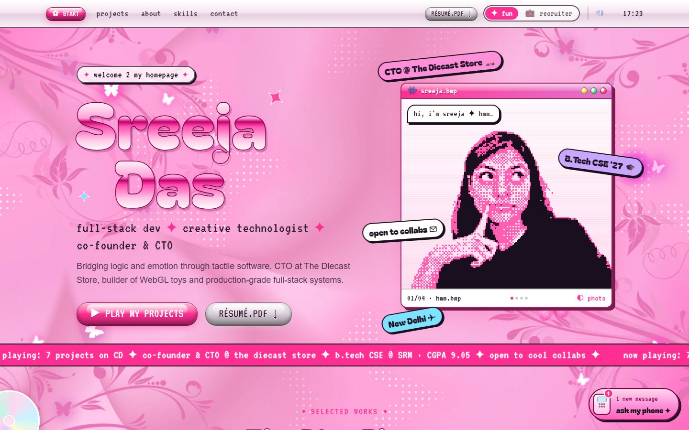

## What's new
- **Y2K design system**: chrome bubble type, pixel font, glossy buttons, draggable windows, a satin-pink wallpaper with flying butterflies, a butterfly cursor and trail, and a new favicon.
- **Pixel portrait**: a flip-book of expressions with a grab reaction ("where are you taking me?!") and a once-per-visit water-break easter egg.
- **The Disc Player**: projects are CDs, each with its own colour and retro intro, plus live/GitHub links. The full showcases open in a full-screen "bonus track" window.
- **MySpace-style About Me**, a **playable equalizer**, and an **AIM-style contact form** that sends real emails (now in a matching pink template).
- **Recruiter mode** (`?mode=recruiter`): a clean one-pager copied word for word from the PDF résumé.
- **Phone assistant**: a local Q&A engine (no API cost) with big-screen and text-size accessibility modes.
- **Spotify now playing** disc in the corner, hidden until the env vars are set.

| Disc player | Bonus track |
|---|---|
| 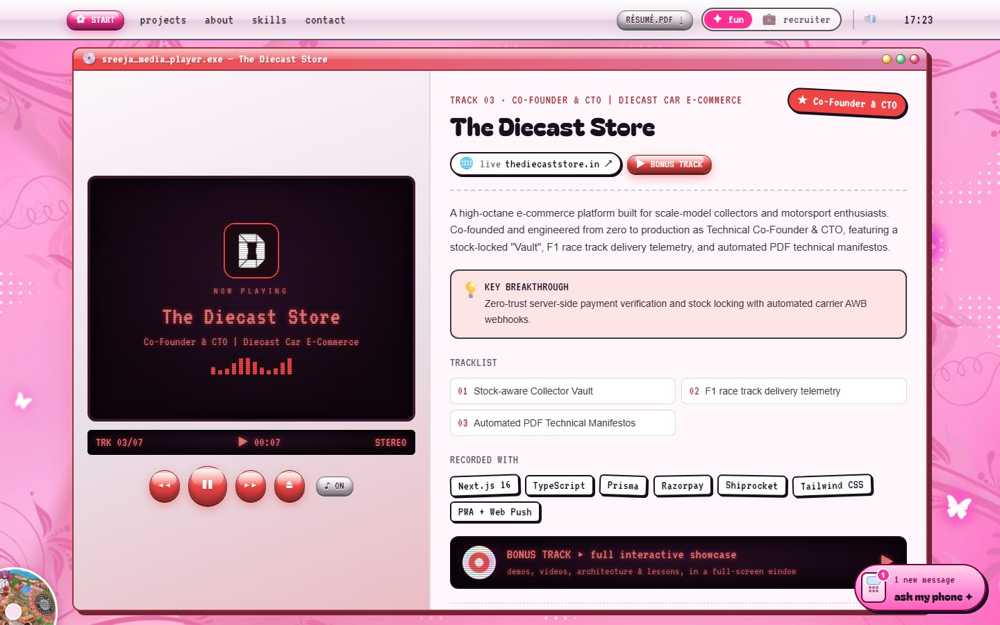 | 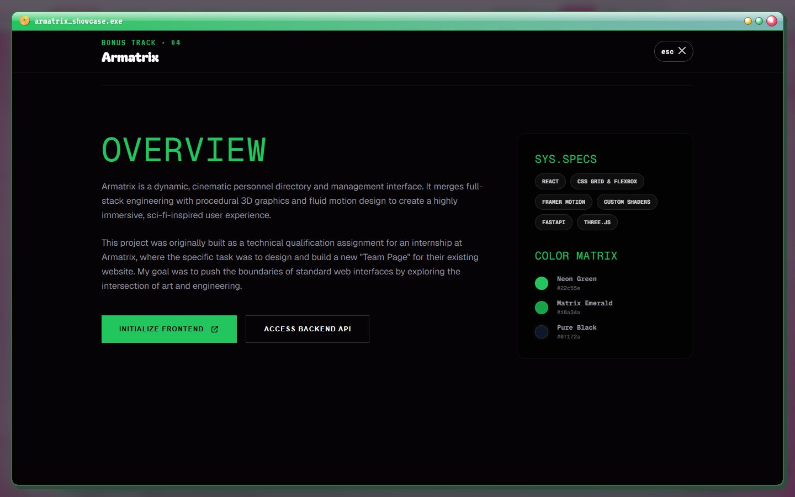 |
| **About Me** | **Equalizer** |
| 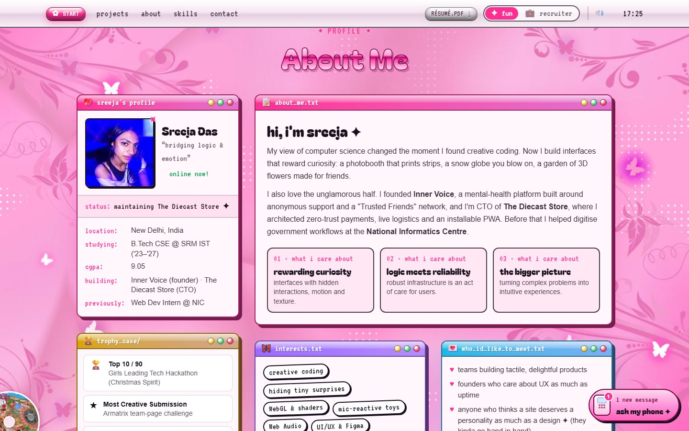 | 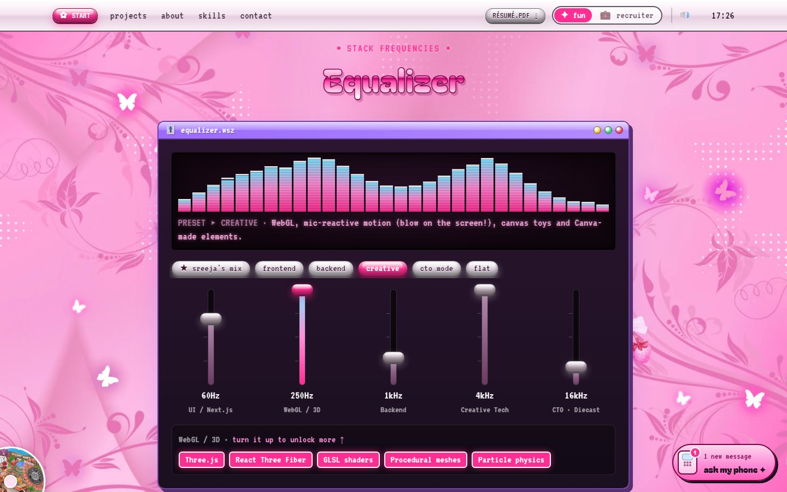 |
| **Contact** | **Recruiter mode** |
| 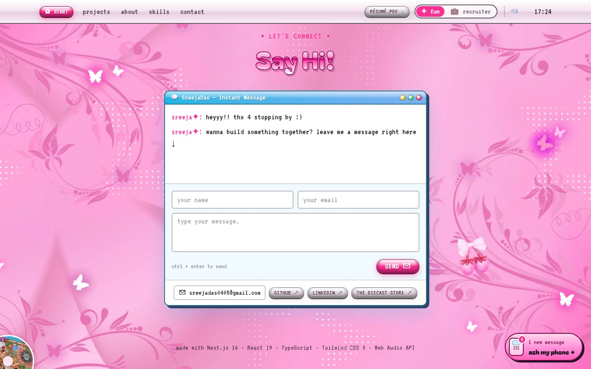 | 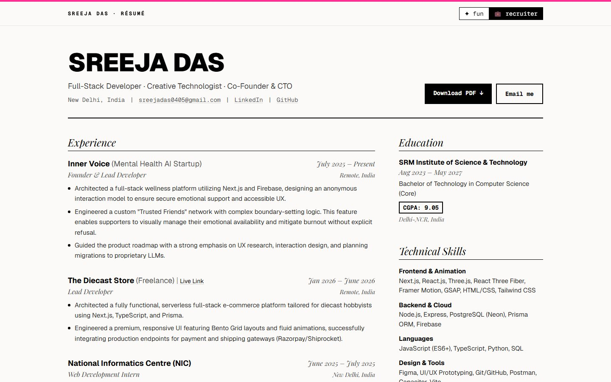 |

| Water break | Spotify disc | Mobile | Mobile player |
|---|---|---|---|
| 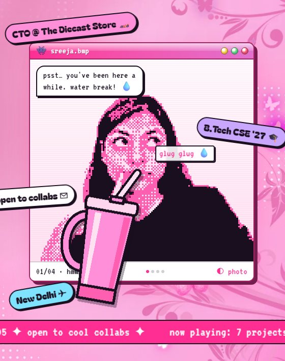 | 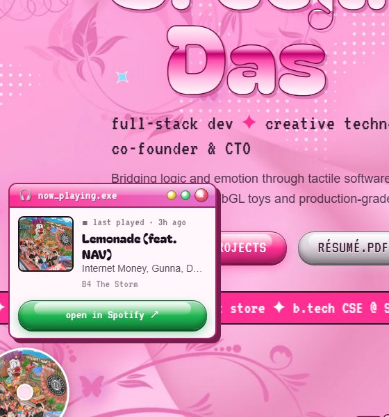 | 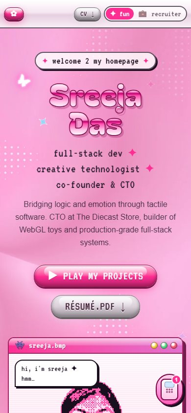 | 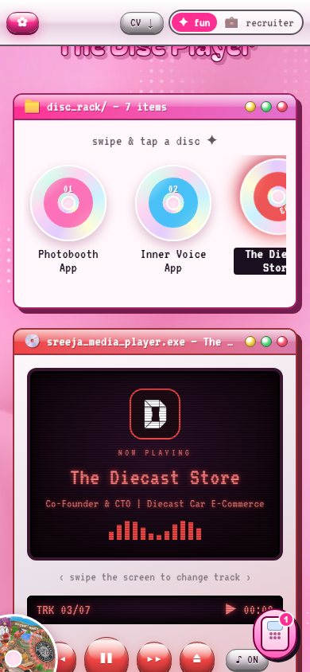 |

## Also
- The contact form escapes and validates input before it goes into the email HTML.
- Animations pause off-screen, behind overlays and in background tabs, and respect `prefers-reduced-motion`.
- Layout fixes for laptop heights and 320px phones; touch versions of every mouse interaction.
- Removed unused legacy components and assets; README rewritten (env vars, Spotify setup, asset scripts).

## Deploy notes
- Add `SPOTIFY_CLIENT_ID`, `SPOTIFY_CLIENT_SECRET` and `SPOTIFY_REFRESH_TOKEN` to the hosting environment to switch on the Spotify disc (see the README). `RESEND_API_KEY` is unchanged.
- The Resend sender is still the `onboarding@resend.dev` test address.

## Testing
- `npm run build` passes; type-check and lint are clean on all new and changed files.
- Checked in a browser at 1440×900, 1536×730 (laptop), 390px, 360px and 320px widths.
