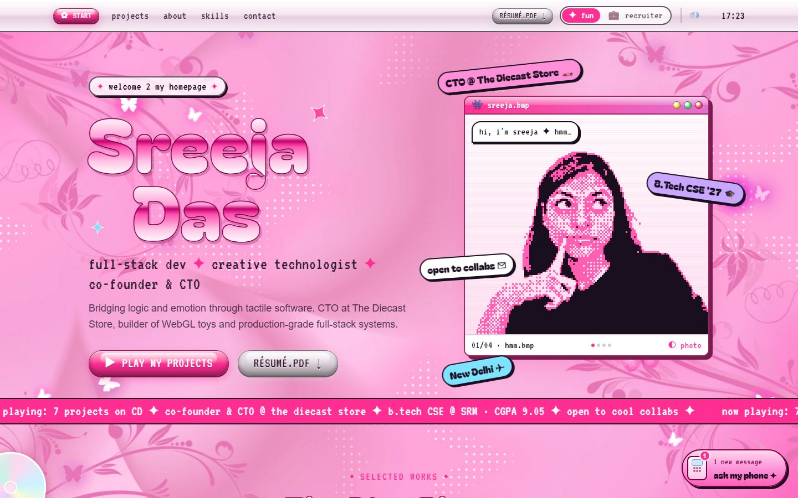

# Sreeja's Developer Portfolio ✧

A Y2K-pink, deeply interactive personal portfolio, "Sreeja OS 2002". It shows off full-stack projects, WebGL experiments and creative coding, and hides plenty of tiny surprises along the way.



## 🚀 Key Features

- **Y2K desktop world:** chrome bubble type, glossy Aqua buttons, draggable windows, a satin-pink wallpaper with flying butterflies, and a butterfly cursor and trail.
- **The Disc Player:** projects are CDs in a rack. Each one re-skins the player in its own colour and plays its own retro intro (F1 start lights, code rain, a microwave ramen, a snow globe…). The full interactive showcases open in a full-screen "bonus track" window.
- **Pixel portrait:** a dithered "Game Boy Camera" flip-book of Sreeja's expressions. It reacts when you drag it, and suggests a water break if you've been browsing a while.
- **Recruiter mode:** a clean black-and-white one-pager mirroring the PDF résumé (`?mode=recruiter`).
- **Phone assistant:** a pink candy-bar phone that answers questions about projects, skills and experience from a local knowledge base. No API costs. Includes big-screen and text-size accessibility modes.
- **Playable equalizer, MySpace-style About Me, AIM-style contact form** (sends email through Resend), and a **Spotify "now playing" disc**.
- **Made for touch too:** tap-for-butterflies, swipe the player, press-and-hold the portrait, and a layout that fits laptops and small phones.
- **Considerate motion:** animations pause off-screen, behind overlays and in background tabs, and respect `prefers-reduced-motion`.

## 🛠️ Tech Stack

- **Framework:** [Next.js 16](https://nextjs.org/) (App Router), React 19, TypeScript
- **Styling:** [Tailwind CSS 4](https://tailwindcss.com/) + a small Y2K design system (`app/y2k.css`, `app/components/y2k/`)
- **3D / creative:** [Three.js](https://threejs.org/), [React Three Fiber](https://docs.pmnd.rs/react-three-fiber), Web Audio API, Canvas
- **Email:** [Resend](https://resend.com/)
- **Deployment:** [Vercel](https://vercel.com/)

## 🏃‍♀️ Running Locally

```bash
npm install
npm run dev
```

Open [http://localhost:3000](http://localhost:3000).

### Environment variables (`.env`)

| Variable | Needed for |
| --- | --- |
| `RESEND_API_KEY` | Contact form email |
| `SPOTIFY_CLIENT_ID`, `SPOTIFY_CLIENT_SECRET`, `SPOTIFY_REFRESH_TOKEN` | Spotify "now playing" disc (hidden if missing) |

### Spotify now playing

1. Create an app at the [Spotify developer dashboard](https://developer.spotify.com/dashboard) (Web API). Set the redirect URI to exactly `http://127.0.0.1:3000/api/spotify/callback`.
2. Put `SPOTIFY_CLIENT_ID` and `SPOTIFY_CLIENT_SECRET` in `.env`.
3. Run `npm run dev` and open `http://127.0.0.1:3000/api/spotify/login`. Approve it, then copy the `SPOTIFY_REFRESH_TOKEN=…` line it shows into `.env` and restart. This helper only works in development.
4. Add all three variables to your hosting provider's environment settings.

### Asset scripts

Both need Python with Pillow and numpy.

- `python scripts/make_pixel_avatars.py`: regenerates the pixel portrait frames from the cutouts in `public/images/sreeja/`.
- `python scripts/make_favicon.py`: regenerates the favicon and app icons from the wallpaper butterfly.

## 🎨 Design Philosophy

Every site deserves a personality as much as its own unique design; the two kinda go hand in hand. This portfolio is meant to be explored: the project player, the hidden interactions and the small jokes all sit on top of solid, production-grade engineering.
